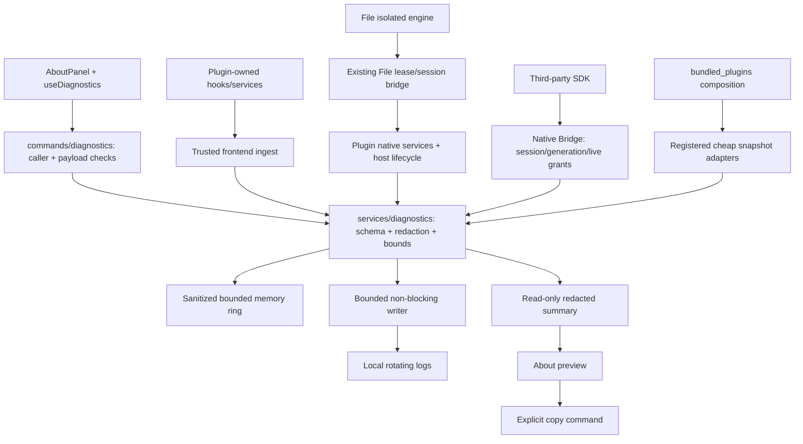

## Context

动机见 [proposal.md](proposal.md)。2026-10-09 已核对当前源码：

| 现状 | 源码依据与设计影响 |
| --- | --- |
| 关于页显示固定 `v0.1.0`、标识和大量英文分类统计 | `src/core/preferences/AboutPanel.tsx`；版本改为原生包 metadata，分类作为可折叠次要信息，全部本地化 |
| 独立 `about` 为 460×420、最小 420×360、不可缩放 | `commands/app.rs`；新增入口需要重新安排高度、内部滚动和诊断预览，不创建新诊断窗口标签 |
| opener 已注册，默认 capability 覆盖宿主窗口 | `lib.rs`、`capabilities/default.json`；复用原生 opener，但新命令必须另外校验调用者，capability 不自动保护应用 commands |
| 迁移和部分 Snap 错误只输出 stderr | `lib.rs`、`services/screenshot.rs`；必须在迁移/状态初始化前建立有界诊断入口 |
| Launch 已有 64 条、单条 512 UTF-8 bytes 诊断 | `services/quick_launcher/mod.rs`；保留原状态协议，变更时同步稳定事件，不能每次读取再次记录 |
| File 有 typed errors、provider readiness 和 lease/session engine bridge | `services/file/{contracts,provider,built_in,engine_bridge}.rs`；诊断必须分阶段且不携带原文、路径和凭证 |
| 扩展面板诊断是即时错误列表；旧 JS Bridge 有 `diagnostics.report` | `PluginManagerPanel.tsx`、`extensionBridge.ts`；不能把旧回调当作持久化日志服务 |
| 新 native Web Bridge 只有 ui/storage/network 方法，公开 runtime 仍关闭 | `plugins/{protocol,session,web_runtime}.rs`、`src/sdk/index.ts`；新诊断方法须接入实际会话通道，并保持公开开关不变 |
| 性能 trace 单独维护，`ZERO_PERFORMANCE_TRACE=1` 时 stderr 输出 | `services/performance.rs`；保持现有格式与证据，普通诊断不自动打开详细性能采集 |

官网由用户确认先使用 `https://www.usezero.cn/`，站点尚未建设；Git remote 为 `https://github.com/bells/zero.git`。截图仅参考入口组织，不照搬 mclip 外观或引入 updater。

## Goals / Non-Goals

**Goals:**

- 支持用户直接找到项目、查阅本地日志、预览/复制能描述故障的摘要。
- 由 Rust 统一决定记录内容、可信身份、持久化与限额；组件/hook 和原生服务用一致事件契约接入。
- 五个内置插件、宿主以及尚在开发的第三方会话都可接入，但权限和生命周期保持各自边界。
- 默认安全日志能区分平台不支持、用户取消、权限拒绝、网络/系统失败、File 包验证/引擎 readiness 等状态。

**Non-Goals:**

- 不做全局实时日志查看器、云监控、自动错误上报、Issue 自动提交、遥测、数据库或诊断压缩包导出。
- 不做检查更新、官网建设、工具运行逻辑重构或新的跨平台功能。
- 不批准 File 候选包，不开启第三方公开 runtime，不扩展截图平台能力；不把日志开启当作文件内容采集许可。

## Decisions

### 1. 关于页保留独立 surface，把支持操作放在可达位置

默认布局：Zero 标识/名称/真实版本 → 简短说明和工具数量 → GitHub/官网两列 → 支持诊断三列（打开日志目录、复制诊断信息、报告问题）→ 可折叠插件详情和诊断详情。扩展诊断详情提供摘要预览、刷新、清理日志；复制按钮复制最后预览的那份快照，若尚无快照先生成并展开，再由用户点击复制。预览明确说明数据范围和缺失信息；不在预览之外偷偷附加日志。

关于窗口建议 500×560、最小 420×360，仍不可缩放，内部滚动；紧凑/高缩放时按钮转为纵向且不少于 40px 高。最终尺寸由真实桌面检查微调，保留拖拽、关闭和焦点行为。采用现有 Zero monochrome glyph、按钮和颜色变量，不以截图的红框或 mclip 圆角装饰为视觉规范。版本通过 `app.package_info().version` 取得，宿主 Rust 同时返回网站与仓库常量；不在 UI 维护另一份版本。网站不可用时用户仍可访问 GitHub/诊断，页面本身不主动探测公网地址。

链接由原生固定目标枚举解析：GitHub `https://github.com/bells/zero`，官网 `https://www.usezero.cn/`，Issues `https://github.com/bells/zero/issues/new/choose`。复用 `tauri-plugin-opener` 的 Rust API。前端不能提供 URL/路径；错误可见并可重试。报告问题不在 URL query 中塞入摘要、路径或日志，复制与提交均为用户独立操作。

备选：在设置添加完整诊断中心。当前只需要关于页入口和展开预览，新增中心会扩大导航/状态管理范围；保留现有 Extensions 内局部错误及其上下文。

### 2. 公共诊断在宿主服务，插件通过组合层注册适配



建议布局为 Rust `services/diagnostics/{contracts,events,redaction,storage,snapshot}.rs` 与薄 `commands/diagnostics.rs`；TS 公共 `core/diagnostics/contracts.ts`、`services/diagnosticsServiceCore.ts`/`diagnosticsService.ts`、hook 和关于页预览组件。模块可以在实施时根据实际复杂度合并，但 core 禁止导入任何具体工具。`bundled_plugins.rs` 注册 plugin-scoped native snapshot adapter；frontend composition 只注册轻量工具身份/允许事件目录，不静态导入完整工具 panel。

快照从已有状态缓存提取，不做文件全文遍历、网络请求、provider 重探测、应用扫描、窗口创建或工具激活。禁用工具显示 disabled；尚未初始化显示 notInitialized；平台不可用显示 unsupported；快照失败显示 error/unknown，并列入摘要 omissions。保留既有 state/error IPC，不用日志来替代业务状态。

### 3. 选择维护中的日志库，业务入口保持严格结构化

2026-10-09 通过上游 README、官方 log 源码及 GitHub API 核对：

| 方案 | 维护依据 | 适配评估 |
| --- | --- | --- |
| [tauri-plugin-log](https://github.com/tauri-apps/plugins-workspace/tree/v2/plugins/log) + `log` | workspace 1,826 stars，未归档，2026-10-08 有提交；源码有 max_file_size、KeepSome 和 split | Tauri 原生友好，大小轮转成熟；默认自由文本/JS console 不适合业务隐私，写入同步，底层失败经日志 facade 难以精确回传 |
| [tracing + tracing-subscriber + tracing-appender](https://github.com/tokio-rs/tracing) | 6,914 stars，未归档，2026-10-08 有提交；appender README 说明 bounded non-blocking worker/guard 和时间轮转 | 结构化事件、专用非阻塞线程与字段过滤更符合公共诊断；时间轮转不等于大小上限，需有显式预算层 |

选择 `tracing`/`tracing-subscriber`/`tracing-appender`，不同时装两套全局 logger。不启用 `attachConsole`，不代理所有 console、panic payload 或第三方依赖自由文本；生产文件 sink 只接收 `zero::diagnostics` 的已验证安全字段。第三方库的网络/IO 错误在调用处转为稳定事件码和安全类别，禁止自动抓全量 reqwest/Wry trace。依赖具体版本在实施时核对 MSRV/锁文件后固定；当前不修改依赖。

用 `RollingFileAppender` 每小时轮转并限制五个归档文件；预算层在 writer 前限制每个小时文件最多 4 MiB JSONL（累计含 newline），不重新实现通用轮转。达到上限后继续更新内存 ring 和 dropped 计数、停止该小时磁盘写入，下一小时恢复；这个有意的取舍保证噪声不能无限写盘。预算按进程启动时现有文件大小恢复，重启不能绕过上限；可观测 Write 包装将磁盘拒绝/写入失败转换为持久化状态，不能静默报告 healthy。总存储上限为活跃文件加五个归档文件、共 24 MiB，后台清理超过七天的诊断文件。多实例使用单个 writer 所有权锁：第二实例以内存模式运行并报告 degradation，避免并发写入/轮转碰撞。

该方案接受高噪声小时内部分日志只有内存记录；若后续产品要求持续完整采样，再独立评估大小轮转 sink。此处把丢失状态作为产品契约，不能通过增大无界缓冲解决。

### 4. 初始化、资源预算与失败行为明确

- 规范目录为 `~/.zero/logs/`；仅创建/维护本服务的文件前缀，拒绝非目录/符号链接逃逸，不读取旧工具目录。Unix 新建目录/file 权限为 0700/0600，Windows 使用用户 profile ACL，不要求管理员权限。
- 在 `run()` 迁移前初始化脱敏与内存服务，生成随机进程 runId，再初始化可用 writer；失败时保留 memory-only 状态，app 正常启动。不能因 logger 初始化失败再触发递归 logger 初始化。
- 生产默认 Info，包含操作完成/关键状态变化及 Warn/Error；Debug/Trace 只由用户显式“临时详细诊断”启用，最长 15 分钟，重启后恢复默认，不放宽脱敏。关闭 about 不影响原生关键日志，隐藏窗口不启动诊断 polling。
- 单条完整序列化事件 ≤4 KiB、内存 ring 200 条、非阻塞 writer queue 512 条。UTF-8 边界截断受控文本，拒绝过大/非法输入；计数与计时保持有限 numeric 类型。队列满不阻塞工具工作，用计数和 coalesced safe notice 表示丢失。
- 对同一 source/plugin/code/outcome 重复事件合并：最多每 10 秒输出一条并带重复次数；第三方另有每插件每分钟 60 条、burst 10 条限流。日志性能不能侵占截图/查询 UI 线程。
- 快照总预算 2 秒，每个适配器 200ms，短锁读取后再序列化；超时返回部分摘要。输出 ≤64 KiB，最近 Warn/Error 至多 50 条；截断必须在合法结构/文本边界并说明 omissions。
- writer guard 由进程生命周期持有，退出最多等待 1 秒 flush；突然 kill/panic 不承诺最后消息完整落盘。不记录未脱敏 panic message/stack，已知 worker panic 记稳定阶段和失败码。
- 清理命令串行暂停 sink、关闭文件并删除/重建本模块日志、清空 memory ring 和已有摘要租约，再恢复；用户需确认清理。不会删除 registry、截图、缓存、用户文档或历史迁移数据；共享状态锁不跨 IO 持有。

### 5. 事件契约：诊断标识不等于权限凭证

Rust/TS 新契约统一 camelCase；Enum 显式对应 wire 值，不改现有 snake_case contracts。事件最少字段为 schemaVersion=1、timestamp（UTC RFC3339）、level、source（host/native/frontend/engine/extension）、pluginId（宿主可为 null）、code、phase、outcome、runId、operationId（可为空）、安全 metadata。客户端只提供允许输入，Rust 决定时间、来源和真实工具归属。

runId/operationId 是专用随机诊断 ID，不复用 File job 的授权 ID、插件 sessionId、lease/token、安装摘要或 Web transport requestId。operationId 由原生操作创建并可作为非授权附加字段返回前端；在插件内部 service/hook 内透传。旧 IPC 不改返回外形时可先保持原生完整关联、前端使用单独关联并在摘要说明关联缺失，禁止用敏感 path/hash 生成 ID。不会因 operationId 而授予任何访问权限。

metadata 只允许 enum、bool、bounded count/duration/status code 与明确批准的静态版本信息。诊断输入不接受任意 JSON object、自由 message、Error.stack、网络 body、stderr/stdout。可信内置代码记录已注册事件码；不直接 `format!("{error:?}")` 落盘。前端 ErrorBoundary/unhandled rejection 仅转为分类码、工具/window 类别，不持久化异常原文或堆栈 URL。用户错误文案继续按原业务模型显示。

事件目录为每个 code 定义允许 phase/outcome 和 metadata keys；公共 metadata 使用具名可选字段（如 count、durationMs、httpStatus、backend、provider、cacheHit、approved、devFallback），不用 `Record<string, unknown>` 直接传输。counts/duration 用 bounded u32，httpStatus 100–599，backend/provider 为注册 enum，版本来自 host/package metadata。单条事件安全字段先验证，再序列化计算 4 KiB 上限，避免仅对 message 截断而让其它字段无界。

第三方输入更严格：只接受 level、插件事件 code、phase、outcome；宿主限定字符集/长度，code 命名空间与真正 plugin identity 分开，标记 `extension` 和 untrusted，不把 self-reported error 当作 host health 结论。不接收可包含任意用户内容的 message；host 自己捕获的激活/Bridge 失败仍使用可信宿主 code。

### 6. 隐私规则适用于记录前和分享前两道边界

| 数据 | 策略 |
| --- | --- |
| 图像、像素、选区坐标、剪贴板内容、窗口标题 | 不采集；Snap 只记录阶段/权限/受控尺寸等级/结果码 |
| 文件名、绝对路径、文档内容、转换产物、OCR、原始 provider 输出 | 不采集；File 只记录 format、provider 类型/版本、批准状态、阶段和结果码 |
| 搜索词、应用目录列表、最近使用记录、任意命令参数 | 不采集；Launch 仅数量/延迟/索引和 watcher 类别状态 |
| URL query、下载完整 URL、网络响应/headers、账号、环境变量、token/lease/session | 不采集；Paper 用固定 endpoint kind、HTTP code、cache hit、受控错误类别 |
| 路径错误和异常字符串 | 调用处分类为 io.permissionDenied 等；不能仅依靠正则遮住用户名后保存剩余内容 |
| 已装第三方名称/ID、平台版本、插件版本和状态 | 用户主动预览摘要时展示；不带安装路径、用户名、机器名、序列号或设备标识。允许用户知晓已装列表会进入复制内容 |

序列化白名单是主要防线，最终 scrub 是防御层（处理换行、控制字符、常见 credential/path pattern）。未经允许字段丢弃，输入未知/越界拒绝；库/第三方自由文本没有进入文件 sink 的旁路。临时 Debug 同样遵守规则。诊断摘要只由已脱敏 ring、宿主 metadata 和廉价快照组成，不能读取任意日志文件来补全，更不能附带用户文件。

### 7. IPC、调用者与剪贴板契约

以下契约已落实于本变更。跨边界 DTO 都在 TS/Rust 明确定义；计数使用 bounded u32，支持操作使用嵌套 `input` 和 `deny_unknown_fields`，拒绝未知字段。

```rust
#[derive(serde::Serialize)]
#[serde(rename_all = "camelCase")]
pub struct AboutInfo {
    pub app_name: String,
    pub app_version: String,
    pub github_url: String,
    pub website_url: String,
    pub issues_url: String,
}

#[derive(serde::Serialize)]
#[serde(rename_all = "camelCase")]
pub struct DiagnosticsError {
    pub code: String,
    pub message_key: String,
    pub retryable: bool,
}

#[derive(serde::Serialize)]
#[serde(rename_all = "camelCase")]
pub enum PersistenceStatus {
    Healthy,
    MemoryOnly,
    Degraded,
}

#[derive(serde::Serialize)]
#[serde(rename_all = "camelCase")]
pub struct DiagnosticsPreview {
    pub schema_version: u32,
    pub preview_id: String,
    pub generated_at: String,
    pub persistence: PersistenceStatus,
    pub dropped_events: u32,
    pub truncated: bool,
    pub omissions: Vec<String>,
    pub text: String,
}

// Thin handlers validate caller and delegate to the service; shown signatures only.
#[tauri::command]
pub fn get_about_info(window: tauri::WebviewWindow,
    app: tauri::AppHandle) -> Result<AboutInfo, DiagnosticsError>;
#[tauri::command]
pub async fn get_diagnostics_preview(window: tauri::WebviewWindow,
    app: tauri::AppHandle) -> Result<DiagnosticsPreview, DiagnosticsError>;
#[tauri::command]
pub async fn copy_diagnostics_preview(window: tauri::WebviewWindow,
    app: tauri::AppHandle, input: PreviewCopyInput) -> Result<(), DiagnosticsError>;
```

```typescript
interface AboutInfo {
  appName: string;
  appVersion: string;
  githubUrl: string;
  websiteUrl: string;
  issuesUrl: string;
}
interface DiagnosticsError {
  code: string;
  messageKey: string;
  retryable: boolean;
}
interface DiagnosticsPreview {
  schemaVersion: number;
  previewId: string;
  generatedAt: string;
  persistence: "healthy" | "memoryOnly" | "degraded";
  droppedEvents: number;
  truncated: boolean;
  omissions: string[];
  text: string;
}
const info = await invoke<AboutInfo>("get_about_info");
const preview = await invoke<DiagnosticsPreview>("get_diagnostics_preview");
await invoke<void>("copy_diagnostics_preview", { input: { previewId: preview.previewId } });
await invoke<void>("open_support_link", { input: { target: "website" } });
await invoke<void>("open_diagnostics_directory");
```

其余对称输入：`SupportLinkInput { target: 'github' | 'website' | 'issues' }`、`ModeInput { mode: 'normal' | 'verbose' }`、无参 clear/directory。copy/link/clear/directory 成功为 void/null；mode 返回更新后的 `DiagnosticsStatus`。Rust 使用相同 enum serde 值，不用未约束 String 代替模式校验。错误经 service 从 `unknown` 收窄并用 `messageKey` 本地化，hook 维护各操作 pending/error/success，不在 AboutPanel 嵌套大量异步逻辑。

读取、复制、删除、模式切换和打开链接/日志目录只允许原生核对的 `about` window。诊断预览在 Rust 持有最多 2 个、每个 64 KiB、5 分钟到期、绑定调用窗口的快照租约；copy 仅接受 previewId，写入与预览完全相同文本，不重新收集或允许任意文本/path。到期需刷新，关闭关于窗口/清理日志撤销。剪贴板通过官方 `tauri-plugin-clipboard-manager` Rust API；只写，不给 WebView/plugin 开放通用 clipboard 权限。

前端 ingest 为另一条 command，只允许明确宿主工具 label 和经过组合层注册的 code/pluginId 组合；capture/pin 仅 Snap，launcher 仅 Launch，paper 仅 Paper，main/tray 的当前插件由宿主贡献目录和合法 code 校验，不视客户端 pluginId 为授权。禁止 File engine 和 `plugin-*` 调用以上 commands。capability 与 `plugins/invoke_gate.rs` 并不能代替每个 handler 的 caller 校验。

### 8. 工具接入矩阵与错误记录责任

| 来源/工具 | 必须接入的阶段 | 原生权威 owner / frontend 补充 | 安全快照与禁止内容 |
| --- | --- | --- | --- |
| Host | bootstrap、迁移、窗口创建、全局快捷键、status bar、autostart、registry/market/package/lifecycle | host services、`lib.rs`、`plugins/`；设置 UI 只补交互或加载失败 | 平台/版本、窗口类别、shortcut 状态、registry revision、安全兼容性码；不记录 HOME、安装路径、package URL/grants payload |
| Snap `zero.snap` | capture permission/start、目标枚举降级、session/commit、copy/save/pin、cleanup | `services/screenshot*`；capture UI ErrorBoundary/序列化交互失败 | macOS custom/Windows system launcher/unsupported、permission 类别、live session/pin 数；无图片/窗口标题/选择坐标/lease |
| Awake `zero.awake` | enable/disable、timeout/expiry、child exit、Windows power call、shutdown cleanup | `services/caffeine.rs`；UI 仅状态加载失败 | active 状态、后端类别、配置时长/remaining、结果码；无 PID、stdout、环境/命令参数 |
| Paper `zero.paper` | metadata fetch、download、cache read/write、preview worker、apply/export、timeout/cancel | `services/bing_wallpaper/`；UI 预览渲染/交互错误 | cache 数量、backend/availability、HTTP code/endpoint kind；无完整 URL、图片、保存路径 |
| Launch `zero.launch` | initialize/index/cache/watcher、shortcut conflict、launch/focus/system-setting、cleanup | `services/quick_launcher/`；UI 查询失败/渲染错误 | index 状态和数量、watcher/backend、已有 bounded code；无搜索词、应用路径/列表、最近记录 |
| File `zero.file` | provider capability、installed identity/policy/signature/assets、engine create/ready/timeout/crash、job validate/start/end/cancel、output validation/artifact cleanup | `services/file/` 与 `plugins/engine_assets.rs`；engine 只经已有授权 bridge 上报已分类失败 | provider/engine 版本、approved/devFallback、availability 原因类别、队列数量/阶段；无文件内容/路径、nonce/token、provider 输出 |
| External | activate/deactivate、bridge refusal/timeout、permission revoke、cleanup、install/update rollback 与插件主动 diagnostics.emit | `plugins/web_runtime/session` 可信宿主事件；插件 SDK 事件明确标为 self-reported | identity/version/state、host error code；第三方不可读取全局摘要或冒充 host/其他插件 |

规则：原生记录本操作终态一次；frontend 在同一失败已由 native 返回时只显示错误，不再把相同异常全文记录。用户取消一般 Info/outcome=cancelled；不支持/禁用/未初始化是能力状态，不能按每次点击产生 Error。未经用户操作、连续后台失败按合并规则记录。日志写入失败不改变原操作 success/error，也不能再通过同一失败 sink 递归报错。

File repair/reinstall 文案对应诊断必须包含失败阶段：policy、package identity、signature/assets、window creation、readiness、provider execution；approve=false 和 devFallback=true 作为状态事实，不转为“已经修复/获准发布”。读取摘要不为获取信息而创建隐藏 WebView。原始 engine diagnostic/free text 不能直接复制进公共日志，先在 Rust mapping 到受控失败码。

### 9. 第三方通过新增只写 Bridge 方法接入，兼容性不偷渡

在当前 typed method map 与 Rust `PluginMethod` 同步增加 `diagnostics.emit`，SDK 暴露 typed helper，input 为上述严格四字段，output 为 null。仍走 `plugin_invoke` 的 protocolVersion、sessionId、generation、requestId、caller/live-owner 校验与 commit-time 重检；身份由 session owner 注入。请求撤销后不得入队。原始 session/request 凭证不写入诊断。

外部 code 匹配 `[a-z][a-z0-9_.-]{0,63}`，phase 匹配同字符集且最多 32 字符；outcome 为 started/succeeded/failed/cancelled/unsupported，level 为 info/warn/error（临时 verbose 时才允许 debug/trace）。拒绝未知字段和任意 message/metadata；宿主追加 plugin identity 而不是要求插件把 ID 塞进 code。旧 SDK helper 无方法支持时返回 typed unavailable，业务调用者不必把日志失败升级为操作失败。

新增清单权限 `diagnostics.write` 仅代表插件向自己的 namespace 写入；需同步 schema/验证/审批 UI/SDK 文档和 grant 规则。旧包无此 grant 不自动获得，新版本必须明确审批，不复用 ui.message 授权。Host 捕获插件自身的生命周期错误不需要插件授予 diagnostics.write，且不会给插件反向读取权限。

当前 API 1.0.0 公开支持尚未发布，在其开发草案中添加方法；不因本提案改变 Host 0.1.0 或稳定发布承诺。未来面对不支持该方法的宿主，SDK 捕获 method unavailable 并使业务操作继续，不启用 console 或其他 native command 作为逃逸 fallback。旧 JS `diagnostics.report` 若保留，只转换为 legacy-safe 固定码并走现有审批/校验；不让任意 message 自动落盘，不把它纳入新 API 支持声明。

### 10. 活跃变更交界与验收

| 活跃变更 | 本变更责任 | 保持的边界 |
| --- | --- | --- |
| standardize-zero-plugin-protocol | 新诊断方法/权限/SDK、host lifecycle 事件 | 现有独立 WebView、session/generation、公开开关与包门禁；不完成其其他未勾选任务 |
| optimize-preferences-settings | 本地化 About 和诊断反馈，保留 Extensions 局部错误 | 不增加设置中心导航和无关 preference schema |
| systematic-performance-and-code-optimization | 有界 writer/ring/摘要、惰性快照和诊断开关 | 保留 ZERO_PERF、旧事件 schema/历史 evidence；不宣称资源目标已达到 |
| bundle-zero-file-offline-engines / add-file-plugin | 分阶段 provider/engine 诊断 | 不批准包、变更转换质量或预热策略 |
| Launch/Snap/状态栏变更 | 安全事件和既有状态适配 | 不改平台能力、快捷键配置或 capture geometry |

实施验收分为：DTO serde/TS fixtures 与业务级事件分类；伪密钥/路径/内容负面测试；rotation、restart budget、queue saturation、磁盘失败/清理/退出；Bridge 身份冒用/撤销/限流；真实 `pnpm tauri dev` 关于页与五工具失败/取消流程；Windows 设备与打包证据独立。常规 gates、bundle 检查和 `openspec validate --all --strict` 按 AGENTS.md 执行。不得从日志生成成功推断工具实机功能成功。

## Risks / Trade-offs

- [非阻塞持久化可能丢尾部/高峰事件] → ring、dropped/omissions、1 秒退出 flush 与清晰状态；不承诺异常杀进程完整日志。
- [每小时 4 MiB 限额后诊断细节减少] → 同码合并/限流、最近内存快照和 dropped 显示，下一小时自动恢复；所有预算均可测试。
- [安全字段无法保留第三方任意错误文本] → 稳定阶段码、受控分类、诊断开发指南；详细 debug 同样不采集内容，必要原始证据由用户另行主动提供。
- [快照持锁影响工具实时工作] → 只短锁读取已有状态，超时显示 partial，不跨 IO 持锁或启动插件。
- [插件事件自报不可靠] → 可信 host failure 与 untrusted extension source 明确区分，事件归属由 host 注入并隔离限流。
- [网站尚未建设] → 保留用户指定地址，不展示“网站已可用”声明，不让网络失败影响本地诊断。

## Migration Plan

1. 先落地公共契约/脱敏/内存状态与持久化预算，迁移前初始化；写入新 `~/.zero/logs/` 不改旧数据。
2. 接 About read/copy/link/clear/mode 和精简布局，再逐工具接 native/FE/engine 适配，保留原错误模型。
3. 最后接新 Bridge 权限/method/SDK 与未公开开发 fixtures，完成撤销和负面验证；不开放公开 runtime。
4. 回滚时删除本变更入口/采集和新依赖，已有日志保留可由用户删除；不动业务数据、legacy migration 和 File policy。运行时插件新增 grant 记录保留，旧宿主按未知权限拒绝兼容，不自动降权绕过审批。

## Open Questions

无阻塞设计的问题。官网已由用户指定；官网上线时间与最终 Issue 模板名称可以后续调整固定目标，不影响本地诊断契约或任务划分。
