# Snap toolbar group implementation evidence

Date: 2026-10-24 (Asia/Shanghai). Source baseline `b32a1369f7652d8e1a2290929a7ecb2fb5c53f6e`. **19/20 tasks complete; task 4.4 remains open for full native acceptance.** This report records implementation validation before the maintainer's separately authorized commit and push; Git history records that delivery. No specification synchronization or archive was performed. Other changes and their manual acceptance tasks were preserved.

## Final behavior

The maintainer clarified that **the main toolbar must be draggable and its annotation properties must follow; properties cannot move independently**. The final implementation and specs reflect that requirement.

- A fixed left area on the main toolbar contains one icon-only 28×40px dot grip. There is no visible drag text or separate recovery button; double-clicking the grip restores automatic group position, and Enter/Space provides the same action for keyboard users. The original 15 actions retain 40px buttons, 20px icons, grouping, state/focus cues and their own horizontal scrolling. The grip remains visible when actions overflow.
- `useCaptureToolbarDrag` owns the only manual coordinates and the original property side for one capture session. Property coordinates are derived from toolbar position, measured button offset and panel dimensions. The property panel has no drag handle, position-recovery button, portal or independent position state. It retains the existing tool-default style reset.
- Pointer movement on the toolbar handle moves both toolbar and attached properties. Pointerup commits; pointercancel, unexpected lost capture or Escape restore the entire group's starting position and automatic/manual mode. A click without movement does not enter manual mode. Normal lost capture cannot roll back a completed drag. Unmount releases capture and listeners.
- Manual mode preserves the property side and caret association. Tool/object changes, hiding/reopening and crop move/resize retain toolbar coordinates. Arrow keys on the handle move the group 1px, Shift+arrows 10px, without canvas nudge/delete/undo. Movement never enters the reducer, defaults, history, crop geometry, IPC or localStorage.
- Group clamping reserves the largest responsive property height and keeps the toolbar and properties within viewport margins. Very short viewports bound property scrolling. Properties retain horizontal clamping and their visible-button caret when a viewport edge prevents the preferred offset. Viewport/layout changes translate manual coordinates only as needed. Recovery returns the group to the current selection's automatic placement without changing styles.
- Automatic placement centers the actual toolbar, preferring outside below, outside above, then inside bottom, with 8px margins/gaps/inset. Inert hidden measurements cover all six tools and default/selected contexts at the current width and locale; readiness prevents initial layout jumps. Opening/hiding/switching properties cannot shrink the reservation. Geometry controls depend only on the crop, viewport and their measured size: 2px above the crop when there is room, otherwise 2px inside its top. A manually dragged toolbar may cover them without causing displacement. Narrow geometry controls wrap the radius field.
- All six property editors now share two content rows: compact context/colors/options/reset above and inline numeric controls below. Five presets (red/yellow/green/blue/black) plus an accessible Palette icon wrapping the native color input replace the nine-color palette. Narrow panels scroll horizontally rather than reflow; existing valid colors and transactions remain intact. Hidden measurements use the same bordered scroll container as the visible panel and account for natural content height plus scrollbar thickness.
- The five colored tools retain factory red `#ff5252`, compatible with saved green/custom colors and existing objects. Reset affects only the current tool's defaults and preserves the manual toolbar position. Selection borders stay green; Mosaic and Pin gain no color fields.

## Browser QA

Environment: local Google Chrome, existing Playwright installation, Node 24.20.0, pnpm 10.33.0. Browser plugin unavailable; repository Playwright runners were used. Validation used an isolated fixture at `http://127.0.0.1:1423/tests/fixtures/snap/annotation-editor.html`, avoiding the normal Tauri port. `SNAP_TEST_ORIGIN` selects this origin; the default remains port 1420.

Flow: synthetic capture → select crop → move toolbar and attached properties → switch/edit objects and tool defaults → cancel/recover → export/OCR. Native IPC is mocked; DOM, Pointer Events/capture, storage, Canvas and PNG encoding run in Chrome.

| Check | Result |
| --- | --- |
| Correct URL/title, meaningful UI, no framework overlay | Passed |
| Console errors/warnings and ResizeObserver loops | None in final group run |
| Stable below/above/inside automatic layout and inert measurement nodes | Passed |
| Icon-only dot grip, double-click/keyboard recovery and 15 original actions | Passed |
| Toolbar/property movement has matching deltas away from viewport edges | Passed |
| Property blank/header, slider, numeric input and color cannot move or detach the panel | Passed |
| Release/cancel/lost capture/Escape restore complete automatic/manual group state | Passed |
| Keyboard group movement and canvas hotkey isolation | Passed |
| Tool/object/hide/crop move and resize retain manual toolbar coordinates | Passed |
| Manual property side survives crop changes; recovery recalculates current automatic side | Passed |
| 360×480, 360×160, 720×480 bounds, scrolling, fixed grip and visible-button caret | Passed |
| Chinese/English accessible grip labels and new-session reset | Passed |
| Crop-attached strip at 2px; toolbar may cover it without repositioning | Passed |
| Saved-green compatibility, per-tool red reset and unchanged group position | Passed |
| Copy/Save/Pin raw PNGs exclude toolbar/property chrome; OCR retains original input | Passed as fixture evidence |

### Measured geometry

Actual DOM measurements in CSS pixels. Baseline is the HEAD source exported to a temporary fixture using the same 1000×700 viewport and `(200,160,600,190)` crop. The toolbar is 70px narrower than the preceding labeled-grip/separate-reset version.

| State | Toolbar x,y,width,height | Rectangle properties x,y,width,height |
| --- | --- | --- |
| HEAD baseline | 64,358,736,58 | 106,424,519.03,98 |
| Outside below | 158,358,684,50 | 225,416,493.02,76 |
| Outside above, clearing fixed strip | 158,298,684,50 | 225,214,493.02,76 |
| Near-fullscreen inside bottom | 158,641,684,50 | 225,557,493.02,76 |
| Manual 360×480 | 8,422,344,50 | 8,338,344,76 |
| Manual 360×160 | 8,102,344,50 | 8,18,344,76 (horizontal scroll) |
| Manual 720×480 | 8,422,684,50 | 75,338,493.02,76 |
| Chinese manual group | 80,140,684,50 | 147,198,475,76 |

The first move from the normal automatic placement to toolbar `(80,140)` applies the same delta to properties, retains the caret, and leaves crop, history and style storage unchanged. No empty property reservation is rendered.

Before:

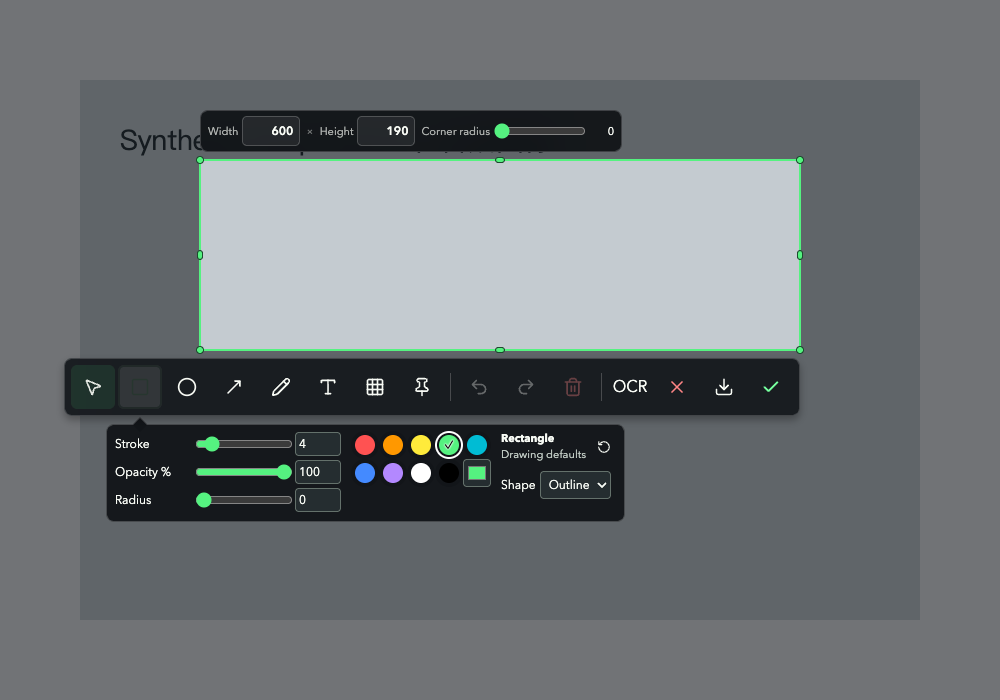

Automatic group below the selection:

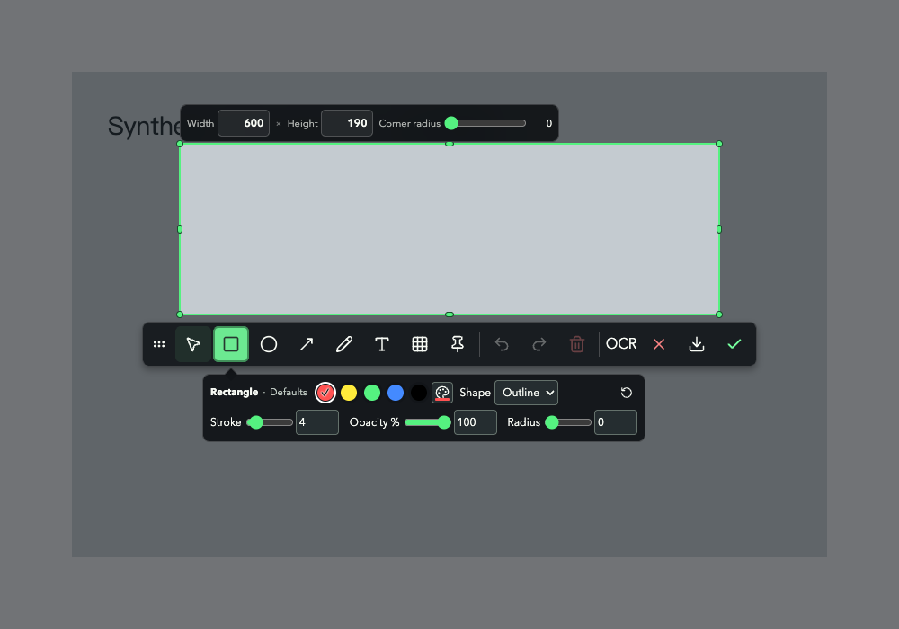

Automatic group above a bottom-edge selection:

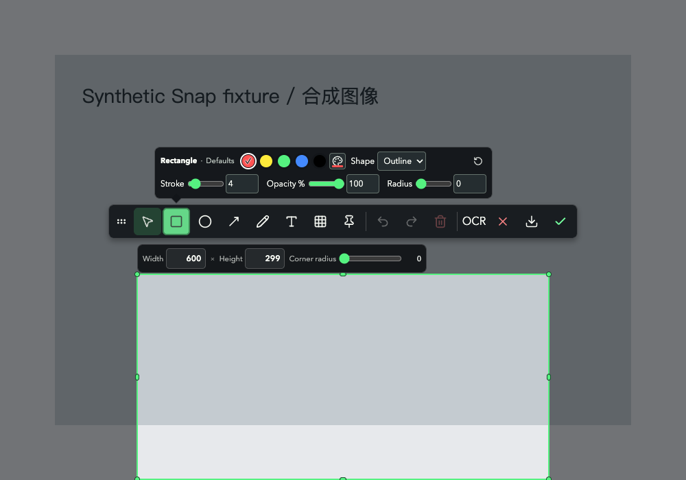

Near-fullscreen inside-bottom placement:

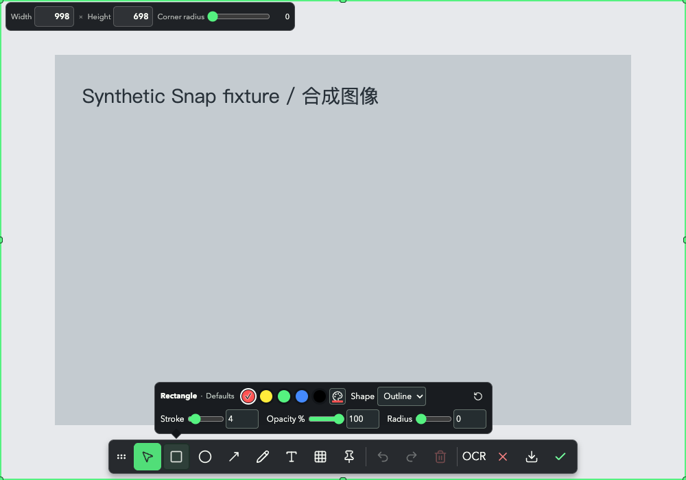

Manually moved group:

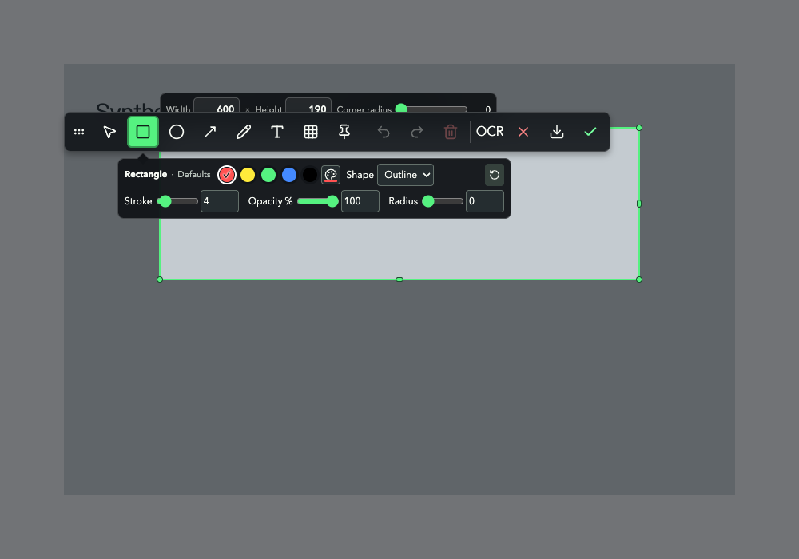

Narrow viewport with the fixed dot grip and scrolling actions:

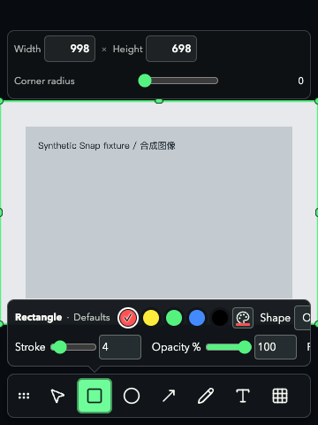

Chinese toolbar and attached properties after a move:

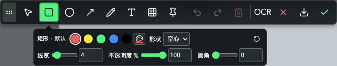

With no room above the crop, its geometry strip stays 2px inside the top edge:

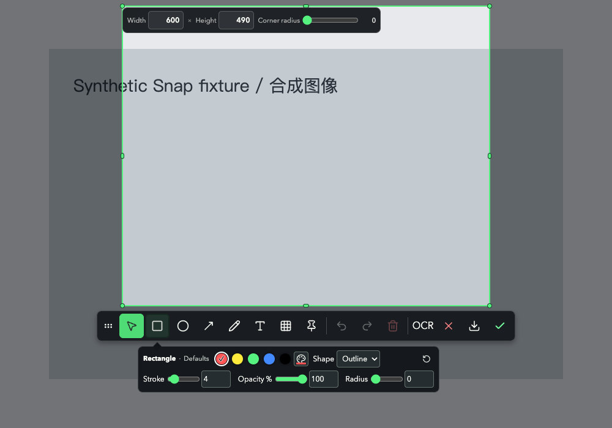

### Output evidence

The group runner decodes three real uploaded PNGs: Copy/Save at 998×698 and Pin at 300×200. Copy/Save preserve exact red `[255,82,82,255]` annotation pixels and known source-background pixels beneath the manually placed toolbar and property panel. The UI is absent from the output. Pin has a distinct PNG lease/upload, and OCR retains the existing original-session/selection request. The separate seven-group Canvas runner verifies compositing, shared preview/final pixels and crop-radius alpha.

## Verification

| Command | Result |
| --- | --- |
| `pnpm test` | 385 passed |
| `pnpm build` | Passed; existing large-chunk advisory remains |
| `node scripts/performance/build-graph.mjs --check --output /tmp/zero-build-graph.json` | Passed, no findings; historical tracked evidence untouched |
| `cargo fmt --manifest-path src-tauri/Cargo.toml --check` | Passed |
| `cargo check --manifest-path src-tauri/Cargo.toml --locked` | Passed |
| `cargo test --manifest-path src-tauri/Cargo.toml --locked -- --test-threads=1` | Native execution: 368 passed, 2 ignored across targets |
| `node tests/browser/snap-annotation.mjs` | 17 groups passed |
| `node tests/browser/snap-floating-panels.mjs` | 10 groups passed, including double-click recovery and fixed crop geometry |
| `node tests/browser/snap-annotation-pixels.mjs` | 7 groups passed |
| `node tests/browser/snap-properties-layout.mjs` | 5 groups passed: six-tool two rows, custom-color defaults/object history, disabled appearance, narrow focus scrolling and Chinese/saved-color compatibility |
| `openspec validate --all --strict` | 35 passed, 0 failed; unrelated archive-dependency info preserved |
| Local Markdown links and `git diff --check` | Passed |

The new group-bound tests failed against the previous implementation before the correction and passed afterward. Browser coverage now explicitly asserts no property-panel drag/recovery controls and matching toolbar/property translation. A separate read-only review found no actionable issues in ownership, measurement dependencies, group bounds, frozen side, cancellation/cleanup or editing/output isolation.

Native/browser tests use permitted local execution because prior sandbox Chrome launch and system Vision/private-pasteboard tests hit environment restrictions. The original sandbox results were preserved in `/tmp/snap-cargo-test-first.log`; assertions were not weakened. Current logs are `/tmp/snap-two-rows-tests.log`, `/tmp/snap-two-rows-browser.log`, `/tmp/snap-two-rows-floating.log`, `/tmp/snap-two-rows-annotation.log`, `/tmp/snap-two-rows-pixels.log`, `/tmp/snap-two-rows-build.log`, `/tmp/snap-two-rows-graph.log`, `/tmp/snap-two-rows-cargo-check.log` and `/tmp/snap-two-rows-cargo-test.log`.

## Remaining native acceptance: task 4.4

The current source compiled and started through `pnpm tauri dev`, with an in-memory configuration override reusing the isolated port-1423 server and skipping a second frontend server. No project configuration file changed and no existing Zero process was running before this check. The owned debug session was stopped after validation.

This startup check was repeated after the two-row refinement, using `ZERO_FILE_ENGINE_DEV_ASSETS=1` for the existing File debug boundary. Desktop automation still could not connect to the unbundled `zero` process (`-10005 timeoutReached`). Therefore the real macOS capture window, actual drag/input/IME, native Save dialog, clipboard and Pin window are not marked accepted. No screenshot-permission failure was observed; this limitation does not establish that native screenshot startup is broken.

Keep task 4.4 open for real macOS below/above/fullscreen, toolbar-group drag/cancel/recovery, attached-property switching, numeric/color/actual IME, Copy/Save/Pin, and separate multi-display/mixed-DPI evidence. Responsive browser checks do not establish mobile support; Windows retains the system screenshot launcher.

## Latest refinement: dot-grip recovery and crop-attached geometry

The maintainer requested removing the visible drag text and recovery button, and making the size/radius strip an anchored part of the crop. New geometry tests first failed against the old 8px/obstacle-driven placement; the visible-label browser assertion also failed before implementation. The final geometry model removes all toolbar/property obstacle parameters. The strip reports its independently computed rectangle in one direction so automatic outside toolbar placement can clear it; the strip never receives toolbar coordinates. Only crop geometry, viewport and control dimensions can change strip position. The normal fixture has crop top160, strip top116 and height42 (2px gap); the top-edge case has crop top10 and strip top12 (2px inset).

A failing regression also caught automatic above-selection overlap; automatic outside candidates now clear the fixed strip before checking reserved property space, including a 4px-high top-edge crop. Manual dragging remains unrestricted by that strip. The browser moves the toolbar over that exact strip, checks unchanged DOM bounds and confirms `elementFromPoint` hits the toolbar above it. It then verifies dot-grip double-click, Enter and Space restore the group without changing the fixed strip. A separate read-only review found no actionable issues in event composition, keyboard isolation or crop-only positioning. All final browser runs have no console errors/warnings.

## Latest refinement: uniform two-row properties and five colors

The maintainer asked to continue optimizing the property editor with two rows for every annotation tool and five common colors plus a picker. The frontend-design and Impeccable distill/layout guidance were applied within the existing editor design. No dependency, IPC or storage-format change was needed.

The first row holds tool/context, five colors, a native custom-color input shown as a Palette icon, existing shape/arrow/bold options and tool-default reset. The second row holds all numeric parameters, keeping both sliders and explicit number fields. Short visible context labels retain the original full localized region names and unit labels. Three-digit numeric values have 48px inputs. Invalid feedback overlays above the field without adding a row. Native color input remains transparent while disabled; its visible wrapper dims instead.

Measured at 1000×700, all six tools have 76px-high property shells, compared with the preceding 98px Rectangle shell (22px / 22.4% shorter). Widths vary with the tool's actual controls; toolbar position remains unchanged. At 360×480, wide panels cap at 344px and scroll horizontally while retaining two rows. Focus on the final numeric field scrolls it into view.

| Tool | English shell width × height (CSS px) |
| --- | --- |
| Rectangle | 493.02 × 76 |
| Ellipse | 419.28 × 76 |
| Arrow | 448.52 × 76 |
| Pen | 336.61 × 76 |
| Text | 349.67 × 76 |
| Mosaic | 184.42 × 76 |

Pre-refinement Rectangle:

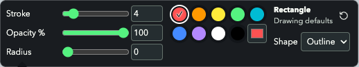

Final English Rectangle:

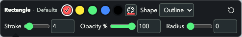

Final Chinese Rectangle:

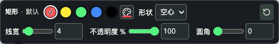

Narrow horizontal scroll after focusing the final field:

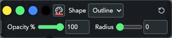

The five-preset test first failed against the nine-color implementation (`/tmp/snap-two-row-palette-red.log`). The browser two-row assertion then failed against the previous UI (`/tmp/snap-two-rows-red.log`). A read-only review found the generic disabled-input opacity rule exposing the transparent native color input above the Palette icon. The added actual-drawing regression reproduced opacity `0.5` instead of `0` before correction (`/tmp/snap-two-rows-disabled-red.log`); it passes after the disabled wrapper/input rules were separated. The new runner also commits a custom selected-object color, verifies one Undo restores red and Redo restores the custom color, then checks saved non-palette purple across reload and Chinese localization.

All 39 browser groups (17 annotation + 10 floating + 7 Canvas/PNG + 5 two-row) passed with no final layout-run console errors/warnings or ResizeObserver-loop reports. These are synthetic Chrome checks. Actual macOS native color-dialog selection, input/IME and output actions remain part of task 4.4.

## Commit-time verification

After the maintainer explicitly requested commit and push, the scoped gates were rerun: 385 frontend tests, build, build-graph budget, Rust formatting/check, all 39 browser groups, 35 strict OpenSpec items, 15 local Markdown links and whitespace checks passed. Task 4.4 remains open.

The first serial Rust run hit the existing one-second deadline in `services::file::process::tests::direct_runner_preserves_argument_boundaries_and_bounds_output` (255 library tests passed, one failed, one ignored). Its isolated rerun passed without source or assertion changes. After browser checks finished and the owned fixture server stopped, a complete serial rerun passed across targets: 368 passed, zero failed, two ignored. The initial failure remains in `/tmp/snap-commit-cargo-test.log`; isolated and full retry results are `/tmp/snap-commit-cargo-targeted.log` and `/tmp/snap-commit-cargo-test-retry.log`.

Other delivery-time logs use `/tmp/snap-commit-` with `tests`, `build`, `graph`, `cargo-check`, `openspec`, `annotation`, `floating`, `pixels` and `properties` suffixes plus `.log`. Commit and push are separate from specification synchronization, archive and native acceptance.
