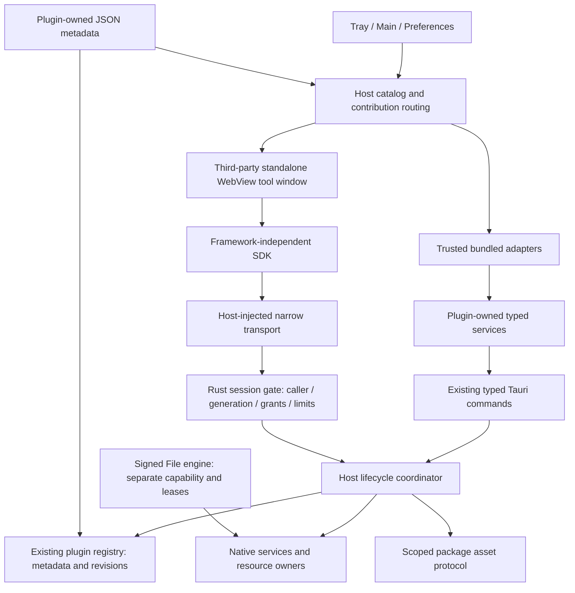
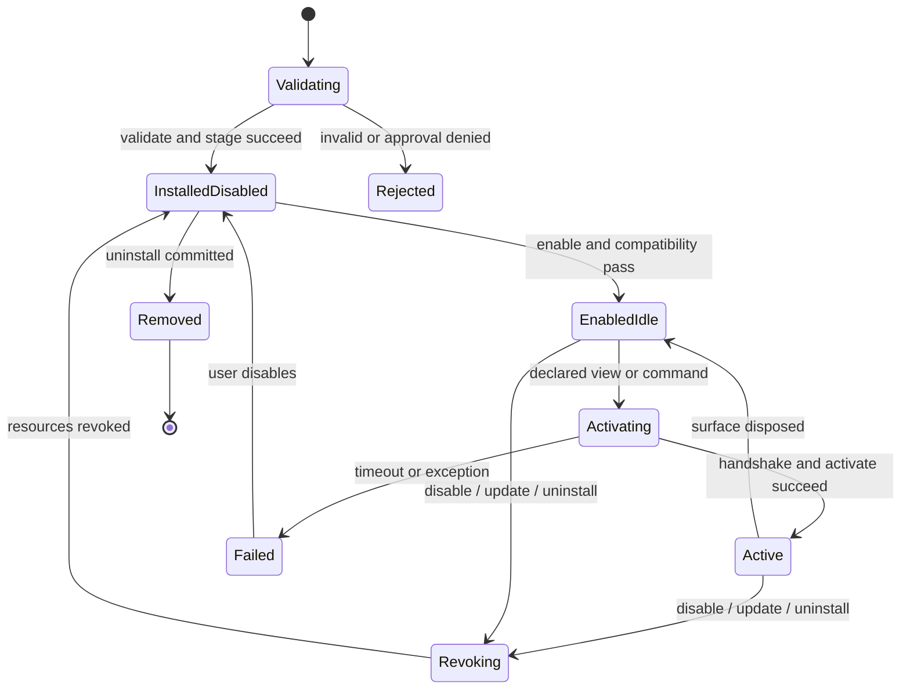

## Context

见 [proposal.md](proposal.md) 的动机与 [源码审查](evidence/architecture-audit.md) 的 A1–A11。当前宿主为 0.1.0，Extension API 标记为字符串 `"1"`；五个工具已分模块，但第三方插件没有被证明可在真实 Tauri 中完成加载、Bridge 调用和停用清理。

本文件提出目标架构；Manifest v2 校验已进入实现；图中的完整运行时与 SDK 仍须逐项验收。2026-09-27 经本机隔离探针及用户确认，第三方视图改为独立 WebView 工具窗口，见 [隔离决策](evidence/webview-isolation.md)。现有 File engine protocol、签名审批与宿主原生命令保持独立，不因本提案获得新的发布资格。

## Goals / Non-Goals

**Goals:**

- 让开发者能判断“包能否安装、当前宿主是否支持、请求为何失败、停用是否已释放资源”。
- 保持内置与第三方两种信任模式，共享身份、贡献、生命周期结果及诊断语言。
- 建立一个真正可用的第三方 Web 示例和 Rust 权威校验链路，再宣布 API/SDK 1.0 稳定。
- 限制常驻工作、注册锁、请求数量和卸载资源，使性能可以测量而非只依赖 hooks 自觉清理。

**Non-Goals:**

- 不建设账号/支付/云市场，不实现插件间依赖解析，不接入 MCP/skills，不嵌入 Node/WASM，不开放任意 Sidecar 或运行时 Rust。
- 不把全部 native invoke 换成 JSON 通用调用，不迁移五个工具现有展示容器，不创建第二套 PluginRegistry。
- 不发布 SDK 包，不改主程序版本/安装标识，不完成旧变更设备任务，不声称独立 WebView 等于操作系统级 CPU/内存配额隔离。

## Decisions

### 1. 一个宿主、两类适配器，Rust 保持资源与授权权威



新增模块放在 `src-tauri/src/plugins/{compatibility,session,lifecycle}.rs`，继续复用 package/registry/engine_assets；跨工具窗口、快捷键、状态栏仍由 host services 协调。`commands/plugins.rs` 调 coordinator，不在每个 command 复制 File/Launch 分支。具体适配器由 `bundled_plugins.rs` 注入；host core 不直接导入具体工具。

选此方案是因为现有内置服务已提供复杂原生能力与高性能媒体路径。强制所有工具经过公用 RPC 会扩大重构并损失领域类型；给第三方直接 import 宿主 React 则会破坏信任边界。

### 2. 版本轴独立，API 稳定承诺晚于接口命名

| 字段/来源 | 含义 | 演进规则 |
| --- | --- | --- |
| Host version | 实际运行的 Zero 版本，Rust 从构建元数据读取 | 不在 TS 再写一份 0.1.0；通过 host info/兼容报告返回。 |
| API version | 本设计目标 `1.0.0` | patch 修复兼容错误，minor 只增向后兼容能力，major 才允许破坏契约；发布前仍标为 draft。 |
| manifest.version | 插件自己的 SemVer | 独立升级，不能强制五个工具统一版本；File 当前 1.0.0 不改回 0.1.0。 |
| manifest.schemaVersion | 新格式整数 2 | 区分无字段 legacy 格式，结构不兼容才增。不是 API major。 |
| SDK package version | 开发工具包版本 | 构建时工具可独立修复；运行时兼容取决于 engines.api 和实际握手，不取决于 npm 版本字符串。 |
| File protocol/package | 现有 engine protocolVersion/packageVersion/hostApiRange | 维持原签名数据含义，不能悄悄重解释 hostApiRange 为新 SDK API range。 |

建议首个支持新格式的宿主版本为 0.2.0；这只是提案决策，不在本轮 bump。示例声明 `>=0.2.0 <0.3.0` 和 `^1.0.0`，当前 0.1.0 应明确拒绝；宿主仍须核实自己具备实现，不能只靠版本宣称兼容。禁止 `>=0.1.0` 无上界地暗示未来所有宿主兼容。

SemVer 2.0.0 管版本，不管 range grammar。v2 范围采用跨语言共同可验证子集：完整 `X.Y.Z`、`^X.Y.Z`、`~X.Y.Z`、空格连接的 `>= / > / <= / < / =` 比较器（AND）；不接受 `*`、缺位数字、`||`、逗号或 hyphen range。候选 Node `semver`、Rust `semver`（已有 serde 栈）优先复用，range tokenizer 只限定语法，不手写版本比较。Rust crate 默认裸版本语义与 npm exact 可能不同，必须转成明确 `=` 后比较，共用 corpus，不能声称“两个包叫 semver 就一致”。v2 必须有上界（精确、^、~ 或显式 `< / <=`），限制误报兼容。

预发布默认不匹配稳定范围；只有显式含同一 core 预发布比较器的范围允许该 core prerelease；build metadata 不影响比较。例：`^0.2.0` 不包含 0.3.0，`^1.0.0` 不包含 2.0.0/1.1.0-beta.1，`1.0.0+abc` 与 1.0.0 同优先级；`01.2.3`、`1.0.0-`、`1.0.0-a..b` 拒绝。版本先校验合法性，再进行范围匹配。

兼容检查时点为安装预检、安装提交前、启动发现、enable、会话激活；失败保留记录并显示 schema/host/api/platform/runtime/permission 的分类原因，拒绝执行。不自动降级到旧 API，不自动下载旧插件。用户明确选择兼容版本或升级宿主后重新校验。

### 3. 延续 manifest.json，严格 profile 与 legacy 适配

可审阅定义见 [TypeScript 接口](contracts/plugin-protocol-v1.ts)、[JSON 示例](contracts/example.manifest.json)、[Rust DTO 子集](contracts/plugin-protocol-v1.rs)。后续建立 draft-2020-12 JSON Schema 和两端 fixtures，Rust 拒绝未知字段；TS 类型不是运行时验证器。

- v2 必须有 `schemaVersion/name/id/version/author/displayName/description/engines/platforms/runtime/main/permissions/contributes/activationEvents`。`name === id`；沿用现有小写安全 ID 语法，建议第三方用 publisher.name，但不强改历史 ID。`zero.*` 保留第一方，author 文字不是身份认证。
- 外部运行 profile 仅 `runtime: webview`；main 必须是包内 HTML 文件，禁止绝对路径、`.`/`..`、URL、反斜线和 symlink escape。视图 ID/命令 ID须以插件 ID 为前缀且唯一；keybinding/status action/activation event 必须引用已声明 ID。
- `contributes` 分开视图、命令、键绑定、设置和状态栏。main/tray 表示宿主入口位置，实际内容由宿主打开独立 WebView 工具窗口；第三方不占据 preferences/about、不任意创建原生窗口。第三方状态栏使用宿主 extension 图标且默认不显示，用户控制是否启用，避免新包挤占菜单栏。
- 首批公开权限仅 storage.plugin/ui.message/network，API 见接口文件。network 还需要非空 HTTPS allowedOrigins，禁止通配符；重定向每一跳、DNS 地址、宿主策略均校验。权限和 scope 更新后重新审批，授权绑定插件 ID、包摘要和批准范围。缺 provider 返回 `api.unavailable`，不能成功返回 undefined。
- bundled metadata 使用内部 `runtime: bundled` + moduleId，公共 archive parser 永远不接受这种自我声明。内置能力权限不等于可对第三方开放的 SDK 权限。File package 继续走独立签名 engine profile。

legacy：无 schemaVersion 的包按旧格式解析，保留 main、name、可选 engines 及 `ztool` 别名；zero 优先。`engines.api: "1"` 只选择 legacy adapter，缺失值不变成 1.0.0。旧声明权限继续保留，但不可自动扩展为 v2 grants；不受新 profile 支持的方法仍明确报 unsupported。先解析验证旧签名字节再生成内存归一化视图，不重写签名 manifest。此提案不要求迁移旧 registry 删除原数据；只在成功提交时升级其记录格式，并备份以支持回退。

为何不采用通用 `entry: {ui, main}`：同时引入 HTML、WASM、binary 会隐藏完全不同的安全/进程/平台语义。未来可通过独立 runtime profile 扩展，而非先写占位字段再允许其执行。

### 4. 安装状态与运行状态分开，hooks 不承担安全清理



Registry 保留安装记录、用户 enabled intent、compatibility、generation；runtime session 独立。enabled 不等于后台常驻，active 以 session 为单位；同插件不同声明 view 可有不同 UI session，同一 view 重复打开复用已有窗口，共享 Rust 插件存储和原生 job owner。首次 view/command 激活才加载；命令先定位/打开其声明 view 并等待 ready，再投递一次。首版不承诺无界面的后台 JS daemon，也不默认启动所有插件。

SDK 采用 `activate(context)` / 可选 `deactivate(reason)`；subscriptions、AbortSignal 帮助作者释放监听器。onEnable/onDisable 是宿主生命周期操作，onInstall/onUninstall 是宿主事务，不运行第三方钩子。这样与 VS Code 的按需激活接近，也避免安装即执行下载脚本。

停用顺序：先撤销新请求权限并递增 generation → 取消/排空宿主 jobs → 尝试 deactivate（上限 2s）→ 无条件关闭 port、销毁插件 WebView、注销命令/快捷键/计时器/资源租约 → 持久化/广播完成。激活上限 5s，普通 Bridge 请求 10s（低于该上限的原生限制优先），最多每 session 32 in-flight，JSON 请求 64KiB、响应 1MiB；这些是初始安全上限，必须经 fixture 和设备测量确认，不能作为已测性能数据。Rust 原生计时器执行 deadline 和窗口销毁，不依赖插件 JS 响应；独立 WebView 仍无 CPU/RSS 硬配额，公开发布前必须在每个平台验证挂死恢复。

Hide 只暂停展示工作，不等于 disable，不终止已接受的原生 job。关闭 Web surface 则撤销该 session；插件数据由宿主持有。内置停用有专属适配：Awake 停原生会话/单一可取消 expiry；Launch 停 watcher/查询并撤销快捷键；Snap 撤销快捷键和活动 capture，已钉图由 host window owner 保持到用户关闭；Paper 停刷新/展示工作；File 进入 draining，取消排队任务、请求取消当前转换并等待现有 lease 回收，超时返回 busy、不删除在用包，清理操作可重试。所有迟到回复因 generation 不匹配丢弃。

卸载默认删包与明确所有的临时缓存，保留持久化插件数据；UI 另提供显式“同时删除插件数据”，不得触碰用户导出文件、未知目录或 legacy 原始数据。卸载不执行不受信插件代码来决定路径。

### 5. 补齐真实 transport，而不是仅导出一个 Bridge 类型

```mermaid
sequenceDiagram
  participant U as User
  participant H as Trusted host UI
  participant R as Rust session/registry
  participant P as Isolated plugin
  U->>H: Open declared view
  H->>R: Activate installed identity and surface
  R->>R: Revalidate version / grants / generation
  R->>P: Create dedicated WebView with scoped assets and bootstrap
  P->>R: Bound bootstrap handshake and plugin_invoke(request)
  R->>R: Check caller window + binding + live grants + limits
  R-->>P: Typed result with requestId
  U->>H: Disable
  H->>R: Revoke generation and resource owners
  R-->>H: registry revision changed
  R->>P: Best-effort deactivate; destroy WebView
  P-->>R: Late reply discarded
```

每个公开插件 view 使用独立原生 `WebviewWindow`，label 由宿主生成并以 `plugin-` 开头。主面板/托盘仅显示入口和会话状态。窗口不属于 default/File capabilities；应用命令总入口先验证 caller label，只允许该插件窗口的窄 Bridge 命令，其他命令全部拒绝。Tauri 插件命令仍受 capability ACL 拒绝。必须实测 raw IPC 绕过 SDK 也不能调用宿主命令，不能仅以 SDK 无 Tauri import 证明隔离。

使用 `zero-plugin` session-scoped 资产协议，将不可猜 token 绑定原生 caller label、插件 ID、包摘要、版本和 generation。协议请求也校验原生 WebView label；拒绝失效 token、跨包访问、编码绕过、符号链接。原生 navigation/new-window guards 拒绝插件主动导航和弹窗；入口由宿主创建，不能加载远程页面。宿主 CSP 继续保持 `frame-src 'none'`。

插件响应 CSP 为 default-src none、受限同会话 script/style/img 来源、connect-src 仅 ipc:/http://ipc.localhost（原生 IPC transport）、frame-src none、object-src none、base-uri none、form-action none、frame-ancestors none。不共享宿主 localStorage/cookies；身份和存储授权一律由 Rust session 决定，不能依赖浏览器 origin。跨平台 scheme/source 行为必须单独验证，失败保持 profile 关闭。

宿主通过原生 initialization script 注入有限 transport，公开 SDK 仅依赖它的 typed request/cancel/register 接口。初始化返回绑定的 PluginSessionInfo；任意插件 JS 都能调用此窄接口，因此 Rust 仍按每次调用验证 caller、session、generation、实时 grants 与方法 payload。不再使用 iframe source/challenge/MessagePort relay，隔离凭据是 Rust 持有的 WebView 绑定，插件自报 ID、origin 或 token 单独均不构成授权。

新的 IPC 示意（兼容报告 DTO 与 TS 请求契约在 contracts；Rust error 保留结构而不是仅 String）：

```rust
#[tauri::command]
pub fn check_plugin_compatibility(
    input: CheckPluginCompatibilityInput,
    state: tauri::State<'_, PluginHostState>,
) -> Result<CompatibilityReport, PluginError> {
    state.check_compatibility(input.manifest)
}
```

```ts
const report = await invoke<CompatibilityReport>(
  "check_plugin_compatibility", { input: { manifest } },
);
// Only the host-injected narrow transport calls this Tauri command.
const response = await invoke<PluginResponse>("plugin_invoke", { input: { request } });
```

`PluginHostState` 是协调器接口占位，不创建第二份 registry。公开 SDK 只调用注入的窄 transport ZeroBridge，不导入 `@tauri-apps/api`。Rust `plugin_invoke(input: PluginInvokeInput, window: WebviewWindow, state: State<...>) -> Result<PluginResponse, PluginError>` 必须从 window 获取 caller；input 不携带自报 caller。完整 tagged method enum 在实施期与 TS map 共用序列化 fixtures。DTO 使用 camelCase；兼容报告的 Option 明确序列化为 null，与 TS null 对称；旧命令继续保留自身 snake_case/camelCase 格式。

重复 requestId 在同 session 内拒绝，已结束请求保留短期有界 tombstone（最多 128 条、30s）；不声称跨崩溃 exactly-once，不自动重放非幂等动作。SDK 本地 AbortSignal 取消等待，宿主 cancellation message 同时撤销在途请求；迟到结果无效，底层不可取消系统调用必须在结果提交前再次校验 session。

### 6. 权威状态、原子提交与短锁

新 registry revision 来自 Rust，成功提交一次递增一次，发 `plugin-registry-changed`，所有宿主窗口按较新 revision 单次合并刷新；乱序事件不回退，重连/显示时补完整快照。事件只是失效通知，不带大 payload、用户文件内容或查询词。兼容错误/权限判断每次 dispatch 读取当前状态，不能使用 React 初始 record 快照当最终授权。

下载先验证允许的 HTTPS 目标与重定向，流式读取并增量计算 SHA-256，达到现有 64MiB 压缩包上限即中止；不能先 `response.bytes()` 再检查。解压还需累计实际输出字节/文件数量限额，超过即清理 staging。market v2 安装要求提供预期摘要，local 安装计算摘要用于审批绑定；这些校验不替代 File 的签名/审批。

安装与更新分 prepare/commit：有界 worker 校验包/摘要/解压到唯一 staging → 获得当前 record generation → 审批新增权限/网络 scope → 以 per-plugin operation gate 协调旧会话 → 短锁 compare-and-swap 发布新 metadata → 释放锁后更新状态栏等。不要在全局 Mutex 内解压、哈希、fsync 或执行 native hook。磁盘 registry 用单写入 owner/版本检查保证内存与持久化一致，提交失败回滚快照与 staging。

更新期间旧已接受任务要 drain，File 保留 engine lease 防删；activation/readiness 失败恢复原版本、原 grants 和 enabled intent，保留故障诊断。旧包保留到新版本首次激活验证通过后才可清理；同版本不同摘要不能静默覆盖。进程中断用提交日志/备份恢复，不能以删除 registry 作为正常恢复手段。

### 7. 内置元数据与 SDK 交付方式

每个 `src/plugins/<tool>/` 拥有一份 JSON metadata。构建/测试验证 JSON，由 Rust include_str 与 TS 静态 import 直接消费同一份 metadata；React loaders/i18n/领域 UI 仍在 plugin.tsx，Rust 行为 adapter 仍在编译组合层。两个静态输出有一致性检查，无运行时跨语言读取/代码加载。

| 工具 | 本次对齐 | 必须保留 |
| --- | --- | --- |
| zero.snap | 元数据、命令/快捷键 owner、停用 capture 清理 | raw media lease、macOS editor / Windows system launcher、pin owner |
| zero.awake | 统一 lifecycle、取消旧 expiry owner | 原生 authoritative keep-awake、隐藏 UI 不等于停止 |
| zero.paper | 元数据和状态栏路由 | 原生 network/cache/preview single-flight、Linux 能力不夸大 |
| zero.launch | command registry 与 watcher/shortcut lifecycle | indexed ID、现有查询/图标调度、隐私规则 |
| zero.file | 元数据和 lifecycle 事件 | 独立引擎 capability、签名策略、序列队列、busy/lease、不同平台 provider |

公共 SDK 建议仓库内 `packages/plugin-sdk`，先私有构建；核心依赖仅通信/契约，React adapter 用 peer dependency。`registerPlugin` 注册的是当前隔离 realm 的函数，manifest 负责宿主贡献发现，不能靠 register 获得声明外权限。`useZeroPlugin` 不负责安装、宿主 enabled 状态或原生资源授权。第三方 notes 示例从打包、安装、用户审批、激活、存储到卸载实测，不假装五个 native 工具可直接复制成第三方。

开发者工具优先使用成熟库：严格 schema 可采用 Ajv（开发期）和 Rust serde + 经评估的 JSON Schema validator；现有 pnpm semver 6 仅传递依赖，不依赖其偶然存在。实施第一步记录候选维护/许可证/体积/语义测试结果，再明确锁定依赖；不在纯提案阶段安装库或自制完整 SemVer 引擎。

## Risks / Trade-offs

- [WebView 不是 OS 资源沙箱] → macOS 探针已证明挂死插件时宿主心跳继续，尚不能证明窗口销毁/全部资源回收或 Windows 隔离；完整设备门禁前不开放公共 profile。
- [v2 严格校验改变作者体验] → legacy parser、字段级诊断、离线 validate 工具和示例迁移文档，不静默丢弃未知字段。
- [新增后台基础设施增加常驻成本] → 默认按需激活、零空闲轮询、单实例协调器，维持现有 lazy graph gate。
- [平台 CSP/scheme 差异] → 在 Windows/WebView2 和 macOS/WKWebView 分别验证后声明支持；不从清单推断 Linux/mobile 可用。
- [声明权限与真实 native 特权混淆] → public Web profile 与 bundled/first-party engine 分离；授权绑定摘要与 scope，package 不能声称自己可信。
- [旧规范仍在活跃 changes] → 保留原任务和场景，本提案附依赖表；实施完成后按依赖顺序显式同步，不借此审查归档。

## Migration Plan

1. 确认本提案后先实现共享 fixture、Schema v2 和兼容报告，应用仍使用 legacy；先不切换五个工具。
2. 完成 Web session/资产协议/真实消息链路与负面用例，功能开关默认关闭。任何安全/平台 gate 失败均不打开公共安装 profile。
3. 引入 lifecycle coordinator/revision 与 prepare/commit；接入现有 native adapters，分别完成五个工具验收，解决 A4/A8/A10。
4. 同步五个工具静态 metadata，验证 ID、版本、平台能力、旧偏好/注册表、File 签名 byte payload 无意外变化。
5. SDK + 第三方 notes 示例完成真实双窗口、更新/回滚、停用/卸载场景；通过 macOS 与 Windows gate 后才发布文档所声称的平台。
6. API v1 freeze、首发宿主版本与 SDK 发布分别显式审批。回滚：关闭新 profile 激活、撤销 session、保留 v2 安装数据但标 unsupported；恢复已备份 registry 与原版包/批准权限，内置服务继续走旧适配器。不得让旧宿主静默执行无法理解的 v2 包。

## Open Questions

- 对外 SDK npm scope 与仓库发布位置：待确认命名归属时选择，不影响协议语义或本地包边界。
- 安全上限之内的更严格性能预算：依据设备采样决定，不以未测数字承诺性能提升。
